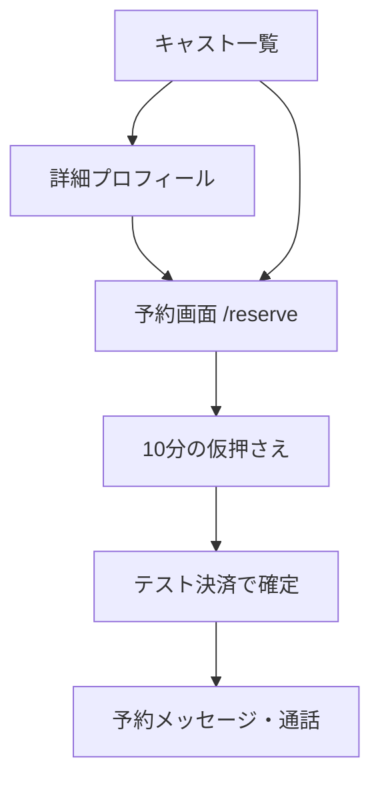
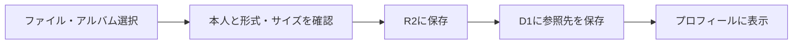

# mimy.

**予約・チャット・音声／ビデオ通話で、会話の時間をつくるサービス。**

[公開サイト](https://tsukino-talk-1025.haru-stoko.chatgpt.site) · [ヘルプ](https://tsukino-talk-1025.haru-stoko.chatgpt.site/help)

> 現在はテスト決済です。実際の請求・返金・キャストへの送金はありません。
> GitHubへのpushと、公開サイトへのデプロイは別の操作です。

## 目次

- [クイックスタート](#クイックスタート)
- [ディレクトリと編集先](#ディレクトリと編集先)
- [画面と操作フロー](#画面と操作フロー)
- [環境変数](#環境変数)
- [データと権限](#データと権限)
- [開発・公開の手順](#開発公開の手順)
- [制限とトラブルシューティング](#制限とトラブルシューティング)

## クイックスタート

### 1. 環境

| 必要なもの | 指定 |
|---|---|
| Node.js | 22.13以上（24系で開発） |
| pnpm | 11.25.0：`package.json` の `packageManager` に合わせる |
| Git / VS Code | リポジトリの取得・編集 |

Windows + WSLでは、以下はすべて **WSL側のターミナル**で実行します。

```bash
git clone https://github.com/aowork777-collab/mimy.git
cd mimy
node -v
npx --yes pnpm@11.25.0 install --frozen-lockfile
```

### 2. ローカルのデータベースを準備

```bash
npx --yes pnpm@11.25.0 db:local
```

確認が表示されたら内容を確認して適用します。`--local` はローカルD1だけを対象とし、本番データには接続しません。`wrangler.local.jsonc` はこのコマンド専用です。Viteの開発用DB設定と同じ識別子を指定しています。

### 3. 起動

```bash
npx --yes pnpm@11.25.0 dev
```

ターミナルのURL（通常 `http://localhost:5173`）を開きます。停止は `Ctrl+C`。

通常のcloneはportableモードになり、ログインボタンで固定のローカルユーザー `local_seedy` / `seedy@sites.test` として入れます。本物のChatGPT認証ではありません。DB初期化だけではキャストや予約は作成されません。

ローカル管理者を試す場合、未追跡の `.dev.vars` を作成します。

```dotenv
ADMIN_EMAILS="seedy@sites.test"
```

変更後は開発サーバーを再起動してください。ローカルは固定ユーザーのため、複数人の役割検証は `tests/service.test.mjs`、実際の別アカウント操作は公開環境で行います。

## ディレクトリと編集先

| フォルダー | 役割 | 主なファイル |
|---|---|---|
| `app/` | URLごとの画面とAPI入口 | `page.tsx`, `layout.tsx`, `globals.css` |
| `app/reserve/` | キャストを選択した予約画面 | `page.tsx` |
| `app/api/` | サーバー処理への接続 | `workspace/`, `call/`, `cast-photo/` |
| `components/` | 再利用するUI | 下の機能対応表を参照 |
| `lib/` | 認可・予約・アップロードなどの処理 | `workspace-service.ts`, `photo-service.ts`, `call-service.ts` |
| `db/` | DBテーブルの設計 | `schema.ts` |
| `drizzle/` | 生成済みのDB変更履歴 | SQLと`meta/`。適用済みファイルは編集禁止 |
| `public/` | ロゴなど固定の公開ファイル | ユーザーのアップロード写真はここに保存しない |
| `tests/` | SQLiteとモックを使った統合テスト | `service.test.mjs` |
| `scripts/` | Vinext・Sitesの起動／ビルド補助 | 通常のUI編集では変更不要 |
| `worker/` | Cloudflare Worker入口 | `index.ts` |
| `.openai/` | Sitesのプロジェクト・保存先設定 | `hosting.json`。秘密鍵を記載しない |

### 何を変えたいとき、どこを編集する？

| 変更したいこと | 編集先 |
|---|---|
| 色・余白・モバイル表示 | `app/globals.css` |
| トップ・アカウント・予約フォーム | `app/page.tsx` |
| キャスト一覧・詳細・ひとこと欄 | `components/cast-directory.tsx` |
| 写真選択・保存表示 | `components/photo-picker.tsx` |
| 写真の権限・サイズ・形式チェック | `lib/photo-service.ts` |
| 通話UI / 参加権限 | `components/voice-call.tsx` / `lib/call-service.ts` |
| 招待URL発行 / 承諾画面 | `components/admin-invitations.tsx` / `app/admin-invite/page.tsx` |
| FAQ・規約・プライバシー | `app/help/`, `app/terms/`, `app/privacy/` |
| 文字サイズなどの表示設定 | `components/preferences.tsx` |
| プラン料金・時間 | `lib/catalog.ts`（サーバー側でもこの定義を使用） |

## 画面と操作フロー



- 詳細の「このキャストと話す時間を選ぶ」は `/reserve?cast=ID` へ移動。
- 空き枠ボタンは `&slot=ID` を付けて日時を引き継ぐ。
- 予約ページの再読み込みでもキャスト指定を維持。料金・空き枠はサーバーで再検証。
- キャスト申請 → 管理者の承認 → プロフィール／シフト登録の順で公開。
- アカウント名は本人の `members` に保存。キャストの公開名は別項目。

### 写真の保存



JPEG・PNG・WebP、3MB以下。承認されたキャストだけが自分の写真を変更できます。選択すると即保存します。1人1枚の保存先を上書きするため、交換ごとに画像が蓄積しません。HEICはJPEGに変換してください。写真配信時もキャストの公開状態を確認し、位置情報などのメタデータを除去します。既存のHTTPS写真URLは互換性のため表示を維持します。

追加した送信制限・写真のメタデータ除去・ライブラリ更新の保守方法は [セキュリティ対策の保守](docs/security-maintenance.md) を参照してください。

## 違反アカウントの管理

管理者画面の「登録アカウントの管理」で表示名・IDを検索し、理由付きで利用停止／解除できます。利用停止すると新規操作を拒否し、仮押さえ・確定予約を取り消します。履歴を削除せず、操作記録を残します。解除しても取り消した予約は復活しません。管理者自身や管理者として保護されたアカウントの停止は対象外です。

本人確認・年齢確認・実決済は追加していません。予約の年齢確認チェックも外していますが、18歳以上の利用条件は維持しています。

## 環境変数

| 名前 | 用途 | ローカル／本番の設定場所 |
|---|---|---|
| `CALL_GUARD_URL` | 専用通話終了WorkerのHTTPS URL | Sitesランタイム環境変数 |
| `ADMIN_EMAILS` | 初期管理者のメール一覧（カンマ区切り） | `.dev.vars` / Sites秘密環境変数 |
| `LIVEKIT_URL` | `wss://…livekit.cloud` | 同上 |
| `LIVEKIT_API_KEY` | LiveKit API key | 同上、公開禁止 |
| `LIVEKIT_API_SECRET` | LiveKit API secret | 同上、公開禁止 |
| `LIVEKIT_FREE_PLAN` | 無料Build契約を確認して `build` | 同上 |

`DB` と `BUCKET` はそれぞれD1とR2のバインディングです。本番では `.openai/hosting.json` をもとにSitesが接続します。ローカル保存先は本番とは別です。秘密値・`.dev.vars`・本番データをGitへ入れないでください。

## データと権限

| テーブル | 内容 |
|---|---|
| `members` | アカウント・表示名・キャスト権限 |
| `cast_profiles` | 公開プロフィール・承認状態・写真参照 |
| `shifts` / `reservations` | シフト・予約・期限・テスト決済状態 |
| `conversation_messages` | 予約当事者間のメッセージ |
| `admin_invites` | 招待先メール・トークンのハッシュ・期限・承諾状態 |
| `reports` / `audit_events` | 問題報告・操作履歴 |

管理者招待はメールを指定して専用URLを発行し、本人がログイン・承諾します。24時間・1回限りで、未使用なら取消可能です。メールは自動送信しません。初期管理者はサーバー設定、追加管理者は使用済み招待の記録から判定します。

旧 `bookings` / `slot_locks` / `messages` / `events` は旧検証用で、現在の予約処理には使用しません。削除せず保全しています。

## 開発・公開の手順

```bash
# 型と動作を確認
pnpm exec tsc --noEmit
node --test tests/service.test.mjs

# DB定義を変えたときだけ
pnpm db:generate
pnpm db:local

# 本番用ビルド
pnpm build
```

1. 対象機能のファイルを編集する。
2. DB変更があればマイグレーションを生成し、既存データの互換性を確認する。
3. 型チェック・関連テスト・ビルドで確認する。
4. ソースと新しいマイグレーションをGitHubへ保存する。
5. Sitesで同じソースを同期・ビルドしてバージョン保存・デプロイする。

**GitHubへのpushだけでは公開サイトは更新されません。** Sitesは公開時にDBマイグレーションも適用します。

## 制限とトラブルシューティング

| 症状 | 確認すること |
|---|---|
| `No package.json` | `pwd` / `ls` でプロジェクトのルートにいるか確認 |
| `EBADENGINE` | 実行中のターミナルで `node -v`。WSLとWindowsは別環境 |
| `no such table` | ローカルで `pnpm db:local` を実行したか |
| ログインが必要と表示される | ローカルでもログインボタンを押す。`localhost` で開く |
| 写真を保存できない | 3MB以下・対応形式・キャスト承認状態・`BUCKET`バインディング |
| 通話できない | LiveKit設定、予約の確定・時間・当事者、機器の許可 |

- 本番で受け取る認証ヘッダはSitesが検証します。他ホストへ移す場合、利用者が送った同名ヘッダを直接信頼しない認証層が必要です。
- 通話のサーバー側終了には専用Cloudflare Workerの接続が必要です。[接続手順](docs/call-guard-setup.md)。未接続の間は新規通話を開始しません。
- 実決済・報酬送金・本人確認・通知・自動退会・写真の自動審査は未実装です。
- 規約とプライバシー案内は運営情報などの確定が必要なドラフトです。
- 自動テストはSQLite／外部通信モック中心です。実ブラウザー・複数端末間通話は別途確認が必要です。
