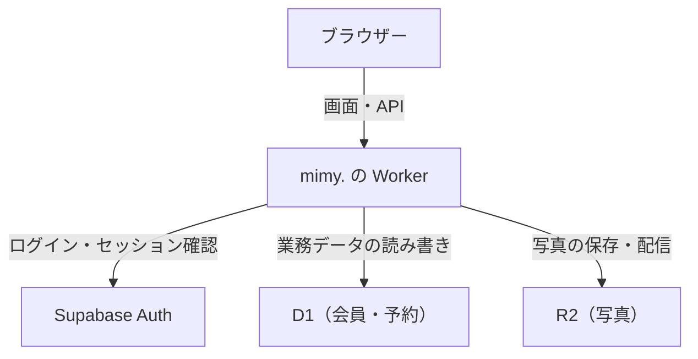
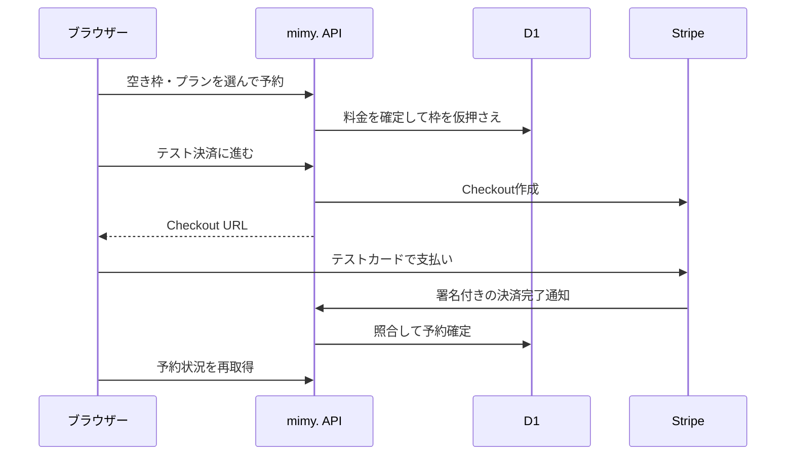

# システム設計書

mimy.は、ログインした利用者が承認済みキャストの空き枠を予約し、予約の当事者がメッセージや通話を利用するWebアプリです。公開サイトはStripeサンドボックスで運用しています。

## アプリの構成

ChatGPT SitesがWorkerとD1・R2を接続します。ログインメールの配信はSupabaseのSMTP設定からResendへ渡します。決済画面はStripe、通話の音声・映像はLiveKitが担当します。各サービスの管理先は [利用ツールと運用先](services.md) を参照してください。

## 認証・権限

[メール認証の処理](../../lib/email-auth.ts) がSupabaseで確認済みの利用者を識別し、`auth_identities` からmimy.の会員IDを取得します。新規会員のIDは通常 `email:<SupabaseのユーザーID>` です。ブラウザーには認証Cookieを設定し、パスワードはSupabase Authで管理します。旧ChatGPT方式の引き継ぎは、移行設定が有効で、旧セッションと確認済みメールの一致などの条件を満たす場合に行います。[移行条件](../email-auth-setup.md#5-既存ユーザー予約の引き継ぎ)

| 権限 | 付与条件 | 主な操作 |
| --- | --- | --- |
| 利用者 `user` | 通常の新規会員 | 空き枠の予約、決済、任意のゲストプロフィール |
| キャスト `cast` | 運営が申請を承認 | 公開プロフィール・日記・シフトの管理 |
| 管理者 `admin` | 確認済みメールが `ADMIN_EMAILS` に一致、またはそのメール宛ての管理者招待を承諾 | キャスト承認、料金区分、会員・予約・購入履歴の確認、利用停止 |

画面の表示名と権限は別です。`members.name` の初期値は「ゲスト」で、キャストの公開名は `cast_profiles.name` にあります。APIはログイン情報から会員IDを決め、操作ごとに権限、本人性、利用停止状態を検証します。チャットの本文は予約の当事者だけが読めます。管理者が全体の予約・購入履歴を見る権限とは分けています。

## 予約と決済

- 予約時間は30分または60分です。料金は [料金定義](../../lib/catalog.ts) でキャストの料金区分に応じて決まり、予約時の金額をD1に保存します。利用者は毎正時の1時間枠を押さえ、通話時間だけがプランによって変わります。
- 空き枠の重複取得はDBの部分一意インデックスで防ぎます。予約状態は `held`（仮押さえ）、`confirmed`（確定）、`completed`（対応終了）、`cancelled`（取消）、`expired`（期限切れ）です。
- 仮押さえは初期10分です。Stripeで支払い画面を作る処理を始めると、支払い期限はその時点から約35分に設定されます。Stripeサンドボックス運用では、開始まで45分を超える空き枠が予約対象です。
- 決済方法は予約ごとに保存されます。既存のデモ予約はサイト内で確定し、新規のStripeテスト予約はCheckoutを使います。
- Stripeへの作成リクエストは予約IDに紐づくべき等キーを使い、同じリクエストの再送による重複作成を防ぎます。Webhookは署名、テスト環境、セッションID、金額、通貨、決済状態を照合します。正当な通知を処理して確定し、同じ支払いの通知が再送されても記録を重複させません。
- 支払い済みでも、通知を処理した時点で予約開始時刻を過ぎている、利用停止中、キャストの承認が外れているなどの場合は予約を確定しません。本番運用でこの状況を扱う手順は [本番決済の準備](../PRODUCTION.md) に記載しています。

## 通話と写真

通話参加は予約が確定済みで、利用者または担当キャスト本人であり、予約時間内の場合に許可します。サイトは専用Workerに終了時刻を登録してから、LiveKitの参加トークンを発行します。専用Workerを接続していない環境では新規通話を開始できません。[接続と検証手順](../call-guard-setup.md)

写真はJPEG・PNG・WebPの3MB以下を受け付け、位置情報などのメタデータを除去してR2へ保存します。日記は公開または推し登録者限定を選べます。限定日記は本文と画像の両方で閲覧条件を確認します。

## D1のデータを読む

| テーブル | 主なデータ・結びつき |
| --- | --- |
| `members`・`auth_identities`・`auth_rate_limits` | 会員の表示名・役割・停止状態、認証IDとの対応、認証の試行制限 |
| `guest_profiles`・`cast_profiles` | 会員IDに対応した利用者の任意プロフィール・キャストの公開プロフィール |
| `shifts`・`reservations` | キャストの空き枠と、枠・利用者・キャストに紐づく予約。StripeのセッションIDや決済状態も予約に紐づく |
| `conversation_messages` | 予約ID・送信者ID・本文・送信日時 |
| `cast_posts`・`diary_photos`・`cast_favorites` | 日記、日記に紐づく写真の参照、利用者とキャスト間の推し登録 |
| `admin_invites`・`audit_events`・`reports` | 管理者招待、操作履歴、通報 |

テーブル定義は [db/schema.ts](../../db/schema.ts)、適用順は [drizzle/](../../drizzle/) にあります。旧検証データの `bookings`、`slot_locks`、`messages`、`events` は現行の予約処理のテーブルと区別してください。
